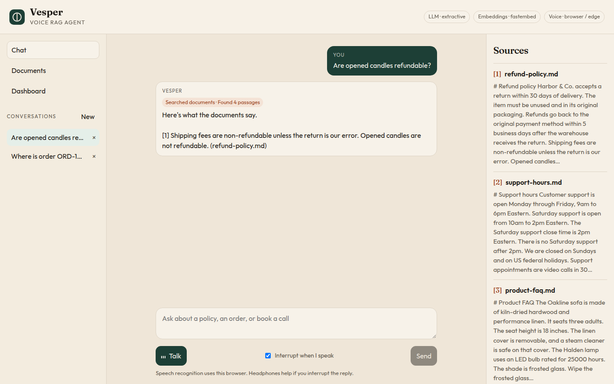
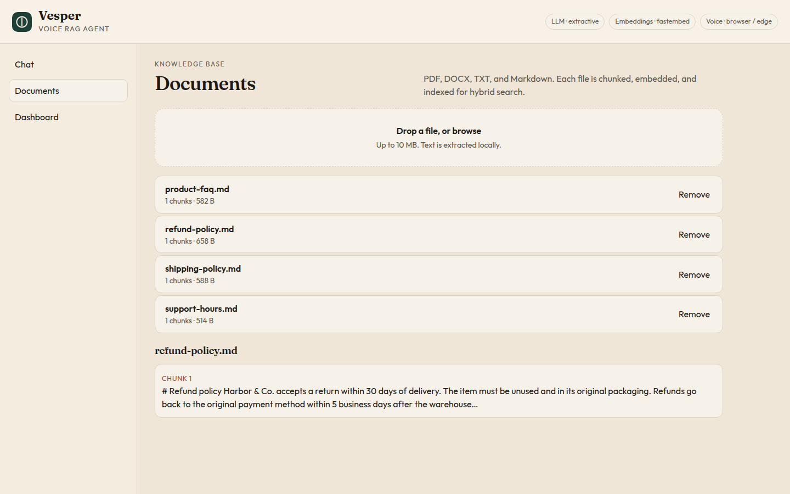
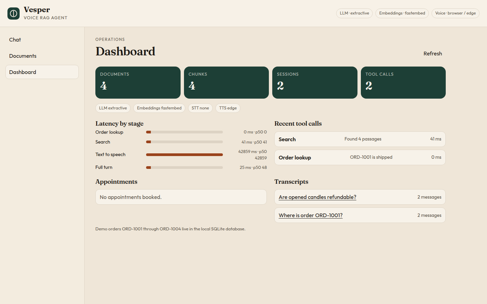
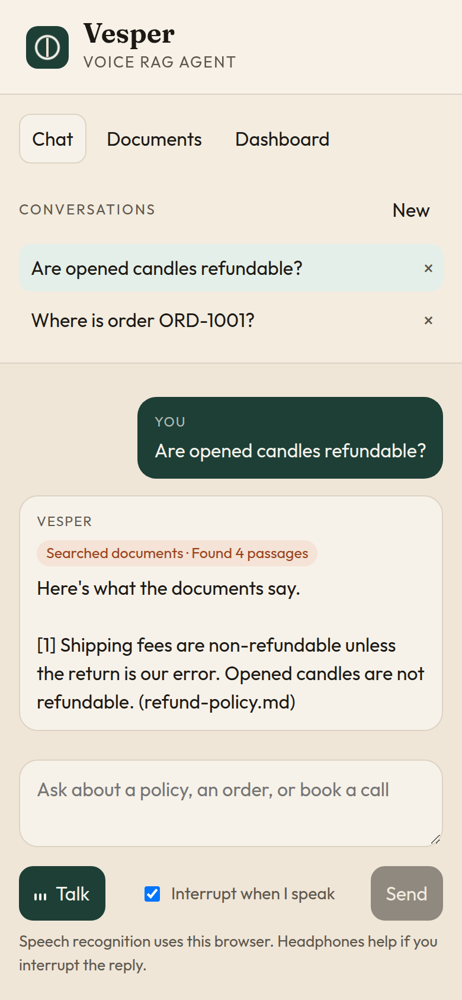
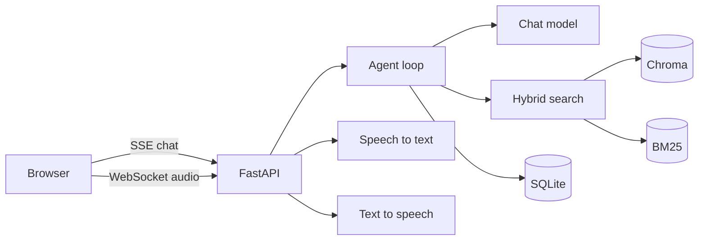

# Vesper

Vesper is a voice agent for a company's own documents. You upload PDFs, Word files, and notes. You type or talk. The agent answers from those documents, shows the passage it used, and can book a support appointment or look up a demo order.

It runs on your machine. The vector index is a local Chroma database. Orders and appointments live in SQLite. No hosted vector database is required. With an empty `.env` it still answers: local embeddings, an extractive reader, browser speech recognition, and [edge-tts](https://github.com/rany2/edge-tts) for the spoken reply.

The sample desk is a fictional home-goods shop, Harbor & Co. Four short policies are loaded on startup so you can try a question before you upload anything.



## Features

- Ingest PDF, DOCX, TXT, and Markdown. Text is chunked with overlap, embedded, and stored in Chroma.
- Hybrid search: vector similarity plus BM25, fused with reciprocal rank fusion, then a small lexical rerank.
- Streaming answers over server-sent events, with numbered citations.
- Tool calls: `search_knowledge_base`, `book_appointment` (saved in SQLite), `lookup_order` (seeded demo orders).
- Conversation memory per session.
- Voice over a WebSocket: microphone audio in, transcript, tokens, then spoken audio back. You can interrupt playback.
- Pluggable models. Chat: OpenAI, Groq, or Ollama. Speech: OpenAI Whisper and TTS, or faster-whisper, edge-tts, and Piper.
- React UI: chat, document upload, and an operations dashboard (transcripts, tool calls, latency per stage).
- `docker compose up --build` for the API and the web app. Pytest, a small retrieval gold set, Ruff, and GitHub Actions.





On a phone the panes stack.



## Architecture



Chat and voice share one agent. The loop may call a tool, then either stream a model reply or, when no API key is set, quote the best matching sentences from the retrieved passage. Every tool call and stage time is written to SQLite for the dashboard.

## Docker

You need Docker with Compose v2.

```bash
cp .env.example .env
docker compose up --build
```

- Web UI: http://localhost:8080
- API: http://localhost:8000
- Interactive API docs: http://localhost:8000/docs

The first build downloads a small embedding model (`BAAI/bge-small-en-v1.5`) into the image. Later starts reuse it. Uploads, the SQLite file, and the Chroma index are stored in the `vesper-data` volume.

Stop it with `docker compose down`. Add `-v` if you also want to drop the volume and start from the sample documents again.

## Local setup

Python 3.12 and Node 22 are what CI uses. A recent 3.11+ and Node 20+ are fine for local work.

```bash
python -m venv .venv
source .venv/bin/activate
pip install -r requirements.txt -r requirements-dev.txt
cp .env.example .env
```

In one terminal:

```bash
make dev
```

That is `uvicorn` with reload on port 8000. In another:

```bash
cd frontend
npm install
npm run dev
```

The Vite dev server is http://localhost:5173 and proxies `/api` to the API, including the voice socket.

`make test` runs pytest. `make lint` runs Ruff.

## API keys

Nothing is required to try the sample questions. Fill in a key only for the provider you want, then restart the API.

| Goal | What to set |
| --- | --- |
| No key, local answers | Leave `LLM_PROVIDER=auto` and `EMBEDDING_PROVIDER=auto`. |
| OpenAI chat | `OPENAI_API_KEY` and `LLM_PROVIDER=openai`. Default model `gpt-4o-mini`. |
| Groq chat | `GROQ_API_KEY` and `LLM_PROVIDER=groq`. Default model `llama-3.3-70b-versatile`. |
| Ollama on this machine | Install [Ollama](https://ollama.com), run `ollama pull llama3.2`, set `LLM_PROVIDER=ollama`. |
| OpenAI embeddings | `EMBEDDING_PROVIDER=openai` and `OPENAI_API_KEY`. |
| OpenAI speech | `STT_PROVIDER=openai` and `TTS_PROVIDER=openai`, plus `OPENAI_API_KEY`. |

Where the keys come from:

- OpenAI: [platform.openai.com/api-keys](https://platform.openai.com/api-keys)
- Groq: [console.groq.com/keys](https://console.groq.com/keys)

Keys stay in `.env`. That file is gitignored. `.env.example` lists every knob with empty secrets.

If a remote model is selected but the call fails, the agent falls back to the local reader and says so in the transcript.

## Free and local models

`LLM_PROVIDER=auto` picks the first option that can actually run: OpenAI if its key is set, otherwise Groq, otherwise Ollama if it answers on `OLLAMA_BASE_URL`, otherwise the extractive reader.

`EMBEDDING_PROVIDER=auto` uses FastEmbed when it is installed (it is, in `requirements.txt`). Set `hashing` for a dependency-free baseline used by the tests. Do not mix embedding providers against an existing index. If you switch, delete `data/` (or the Docker volume) so the collection is rebuilt. The collection name includes the provider and the vector size, so a dimension mismatch starts a new collection rather than crashing a query.

Speech:

- `STT_PROVIDER=auto` uses OpenAI Whisper when `OPENAI_API_KEY` is set. Otherwise the browser's speech recognition is used, and the mic audio stays in the page.
- Optional server-side Whisper without an API key: `pip install -r requirements-local.txt`, then `STT_PROVIDER=faster_whisper`. The first run downloads the `base` model (`WHISPER_MODEL`).
- `TTS_PROVIDER=auto` uses OpenAI audio when that key is set, otherwise edge-tts (no key, needs outbound HTTPS), otherwise Piper if `PIPER_BIN` and `PIPER_MODEL` point at a working install.

Inside Compose, Ollama on the host is `http://host.docker.internal:11434` (already the default in `docker-compose.yml`).

## Try it

The sample documents cover returns, shipping, product care, and support hours. These prompts are also on the empty chat screen:

- How many days do I have to return an item?
- Where is order ORD-1001?
- Book an appointment for Priya Shah, priya@example.com, on 2026-11-03 at 14:00 about a damaged lamp

Booking can be split across turns. "Book an appointment" asks for the missing name, email, date, time, and reason. The next message fills them in.

Demo orders:

| Order | Customer | Status | Notes |
| --- | --- | --- | --- |
| ORD-1001 | Jane Adler, jane@example.com | shipped | Oakline sofa, tracking NL482193 |
| ORD-1002 | Marcus Hale, marcus@example.com | processing | Halden lamp |
| ORD-1003 | Jane Adler | delivered | Wool throw, tracking NL100288 |
| ORD-1004 | Sam Okonkwo, sam@example.com | cancelled | Dining chairs |

Upload your own file from Documents. PDF, DOCX, TXT, and Markdown, up to 10 MB. Removing a file drops it from SQLite, Chroma, and disk.

The Talk button opens the voice socket. Click it again to stop. "Interrupt when I speak" sends a barge-in if the mic hears you during playback. Headphones help, because the speakers can trip the mic. If the browser has no speech engine, the page says so and chat still works.

## HTTP API

Base URL `http://localhost:8000`. The same routes are proxied by the web app under `/api`. OpenAPI is at `/docs`.

| Method | Path | What it does |
| --- | --- | --- |
| GET | `/api/health`, `/api/config` | Status and the active providers. No secrets. |
| GET | `/api/documents` | Indexed files. |
| POST | `/api/documents` | Multipart upload, field name `file`. |
| GET | `/api/documents/{id}` | File plus chunk snippets. |
| DELETE | `/api/documents/{id}` | Remove the file from the indexes. |
| POST | `/api/sessions` | New conversation. |
| GET | `/api/sessions` | Recent conversations. |
| DELETE | `/api/sessions/{id}` | Delete a conversation and its messages. |
| GET | `/api/sessions/{id}/messages` | Transcript, citations, and tool summaries. |
| POST | `/api/chat` | Send `{ "message", "session_id"? }`. Response is `text/event-stream`. |
| GET | `/api/admin/overview` | Counts, latency, recent tool calls, appointments, sessions. |
| GET | `/api/admin/tool-calls` | Tool-call log. |
| GET | `/api/admin/latency` | Average, p50, and max by stage. |
| WS | `/api/voice/ws` | Voice session. |

Chat events are JSON objects, one per `data:` line:

- `session` — session id
- `tool` — name, arguments, short summary, latency
- `token` — a piece of the answer
- `sources` — citations (`n`, filename, snippet, score, page)
- `notice` — a fallback or playback warning
- `error` — something the turn could not finish
- `done` — turn latency in milliseconds

Voice messages from the browser are JSON, except audio, which is binary frames:

- `{ "type": "start", "session_id": "..." }`
- binary audio chunks, then `{ "type": "utterance_end", "mime": "audio/webm" }`
- `{ "type": "text", "text": "..." }` skips speech-to-text
- `{ "type": "barge_in" }` stops playback and the current turn
- `{ "type": "stop" }` closes the turn

The server sends `ready`, then the same `transcript` / `token` / `tool` / `sources` / `done` events, plus binary audio frames for each spoken sentence.

```bash
curl -N -X POST http://localhost:8000/api/chat \
  -H 'content-type: application/json' \
  -d '{"message":"How many days do I have to return an item?"}'
```

## Project layout

```
backend/app
  main.py            app factory
  config.py          settings from the environment and .env
  db.py              SQLite
  state.py           wires embeddings, search, the model, and speech
  api/               health, documents, chat, voice, admin
  ingestion/         loaders, chunker, index pipeline
  retrieval/         embeddings, Chroma, BM25, fusion, rerank
  llm/               OpenAI-compatible client and the local reader
  agent/             tools, intent router, tool loop
  voice/             STT, TTS, barge-in playback
backend/tests        unit tests, API tests, retrieval gold check
evals/               questions and the file each one should rank first
examples/docs        Harbor & Co. sample pages
frontend/            React + Vite UI, nginx config for Compose
docker-compose.yml
.github/workflows/ci.yml
```

## Tests

```bash
make test
make lint
```

The test suite forces the hashing embedder and the extractive reader, so it does not download a model or call an API. `backend/tests/test_eval_retrieval.py` loads `evals/retrieval_gold.json` and checks that each question ranks the expected file first.

CI on GitHub installs the backend, runs Ruff and pytest, then builds the frontend.

## Troubleshooting

**Port already in use.** The API listens on 8000 and the Compose UI on 8080. Stop the other process, or change the host ports in `docker-compose.yml`.

**The page loads and every API call fails.** In Compose, the UI container proxies `/api` to the `api` service. `docker compose ps` should show the API as healthy. Hit http://localhost:8000/api/health directly. A JSON body with `"status": "ok"` means the API is up and the proxy is the piece to look at.

**Answers ignore a file I just uploaded.** Confirm the file is listed under Documents and has at least one chunk. Scanned PDFs with no text layer come through empty. The loader does not OCR.

**I changed the embedding model and search looks empty or wrong.** Delete `data/` locally, or `docker compose down -v`, and start again. Old vectors are not reused across embedding sizes.

**Speech recognition does nothing.** `STT_PROVIDER=auto` without an OpenAI key uses the browser. Chrome and Edge support it. Firefox often does not. Allow the microphone. The error under the Talk button is the browser's message, and typing still works.

**The reply is on screen but there is no audio.** edge-tts calls Microsoft's speech endpoint and needs outbound HTTPS. There is no API key. If that call fails, the socket sends a notice and keeps the text. Set `TTS_PROVIDER=openai` or point `PIPER_MODEL` at a Piper voice if you want synthesis that does not leave the machine.

**Barge-in fires on its own.** The mic is hearing the speakers. Use headphones, or turn off "Interrupt when I speak".

**A proxy buffers the token stream.** The chat response sets `X-Accel-Buffering: no`. The bundled nginx config also turns buffering off for `/api/`. If you add another reverse proxy, disable response buffering on that route and forward the `Upgrade` header for `/api/voice/ws`.

**Docker build is slow the first time.** The image installs Python dependencies and downloads the embedding model. Later builds use the Docker layer cache.

## Roadmap

- Sign-in, and a real separation between tenants
- OCR for scanned PDFs
- More tools (calendar, shipping carrier) behind the same loop
- A larger gold set and a check that answers stay faithful to the cited passage
- Token-by-token streaming for the local reader, not only for remote models

## License

MIT. Copyright (c) 2026 Irsal Khan. See [LICENSE](LICENSE).
